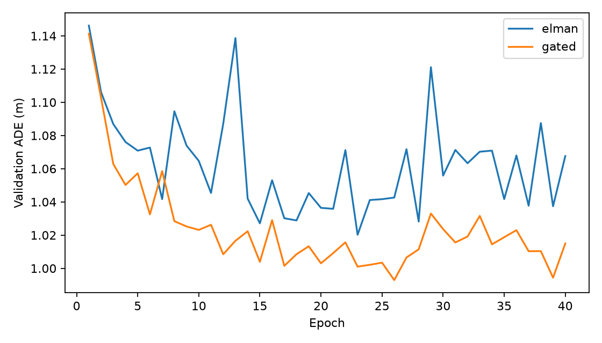
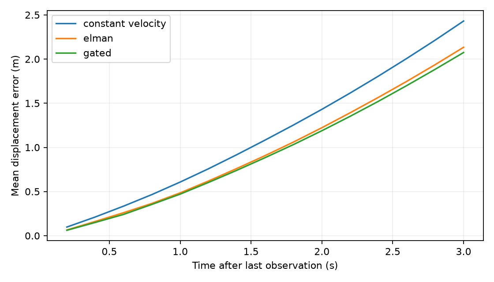

# 基于手写 RNN 的车辆轨迹预测作业

本项目参考附件中的 Elman RNN、`f/g` 接口、`scan`、训练循环和自定义 RNN 结构，将股票预测改为真实车辆轨迹预测。提供可执行的教师版、与教师版一一对应的学生填空版、离线数据、已训练权重和实测结果。

## 1. 数据集选择

| 数据集 | 可用于轨迹预测的内容 | 获取方式与适用性 |
| --- | --- | --- |
| **NGSIM，本文采用** | 车辆 ID、时间戳、道路局部二维位置；原始 10 Hz | [USDOT 官方数据页](https://data.transportation.gov/Automobiles/Next-Generation-Simulation-NGSIM-Vehicle-Trajectories/8ect-6jqj)。公开 API 可下载 CSV，无需登录；适合小型课堂实验。 |
| Argoverse 2 Motion Forecasting | 多交通参与者的二维位置、朝向、速度和地图；250,000 个、每个 11 秒的场景 | [官方数据说明](https://argoverse.github.io/user-guide/datasets/motion_forecasting.html)、[官方 API](https://github.com/argoverse/av2-api)。适合进一步研究交互、多模态预测；格式和规模比本作业复杂。 |
| BridgeData V2 | 机械臂示教序列的机器人状态，可提取末端执行器位置 | [官方项目](https://rail-berkeley.github.io/bridgedata/)、[官方代码和下载说明](https://github.com/rail-berkeley/bridge_data_v2)。提供原始数据与 RLDS/TFDS；转换脚本读取 `full_state` 并输出 `observations/state`。使用前应核实所选版本的状态维度、坐标系、单位和采样间隔。 |
| INTERACTION | 道路交互场景中车辆的二维位置、速度与朝向 | [官方数据入口](https://interaction-dataset.com/)、[官方工具](https://github.com/interaction-dataset/interaction-dataset)。适合路口与转弯预测；通过数据站点按当时流程申请/下载，工具仓库本身不等于完整数据集。 |

这里的“开源数据”指公开可获取的数据；数据使用条款与工具代码的许可证分别确认。NGSIM 官方元数据的 `Rights` 为 `public`，发布者为 FHWA。其余数据请遵守各自官方数据使用条款，不把 API 仓库的 MIT/BSD 许可证当作数据许可证。以上入口与说明于 2026-10-30 核实；本项目实际下载和训练的是 NGSIM。

NGSIM 是道路摄像机采集的真实交通车辆轨迹，不是自动驾驶系统自行产生的驾驶日志；它适用于自动驾驶车辆运动预测。本作业预测车辆前部中心的位置，作为移动机器人轨迹预测的教学实例。

### 本次使用的子集

- 地点：`i-80`；乘用车：`v_class = 2`；`vehicle_id <= 500`。
- 单一记录时间范围：`1113433135000 <= global_time < 1113434035000`，毫秒时间戳。使用完整的查询结果，没有按行数截取单辆车。
- 字段：`vehicle_id, frame_id, global_time, local_x, local_y`。
- 下载了 **169,765 条记录**，保存在 `data/ngsim_i80.csv.gz`，约 1.97 MB，无需再次联网。
- 读取时由英尺乘 `0.3048` 转成米；先检查连续性，再每两帧取一帧，得到 5 Hz。缺帧处拆成不同片段，不跨缺口组成样本；冲突重复记录会报错。
- 车辆 ID 在不同记录时段可能重复，因此本程序只支持所指定的单一记录。扩展到多段记录时，须使用 `(recording_id, vehicle_id)` 作为轨迹标识。
- `data/manifest.json` 保存官方查询 URL、获取日期、来源、单位及原始 CSV 和压缩文件的 SHA-256。

## 2. 模型与实验设计

输入为 15 个历史位置，采样间隔 0.2 秒，覆盖从 -2.8 秒到 0 秒；输出未来 0.2 秒至 3.0 秒的 15 个位置。代码默认张量如下：

| 内容 | 形状 | 说明 |
| --- | --- | --- |
| 原始历史 | `B × 15 × 2` | 位置，单位米 |
| RNN 输入 | `B × 15 × 4` | 相对最后观测点的位置，以及仅用历史计算的速度 |
| 隐状态序列 | `B × 15 × 64` | 手动 `scan` 沿时间迭代 |
| 输出头 | `B × 30` | 一次输出所有未来步的二维残差 |
| 未来预测 | `B × 15 × 2` | 相对最后观测点的位置，单位米 |

先用最后 1 秒的历史位置做线性最小二乘估计速度，生成匀速基线。RNN 编码完整历史，预测相对于此基线的修正：

`future_prediction = constant_velocity_prediction + 10.0 × RNN_output`

`10.0` 是固定的米制尺度，便于训练，不依赖未来数据。输出层初始化为零，所以两个模型在开始训练时都等价于同一匀速基线。它们属于“物理基线 + RNN 残差”的预测模型。

- **Elman RNN**：`h_t = tanh(W_x x_t + b_x + W_h h_(t-1))`。
- **MyRNN**：教师答案采用手写 GRU 门控方程；学生可用相同接口尝试其他递归结构。
- 预测时只给历史和由历史计算的基线；不输入真实未来位置，不使用 teacher forcing。
- 按车辆进行固定 70%/15%/15% 划分，再滑窗；标准化参数只从训练集历史特征计算。
- 验证集 ADE 选择 checkpoint。完成两个模型的训练与选择后，才计算最终测试指标。

默认分割与样本数量：

| 分割 | 车辆数 | 窗口数 |
| --- | ---: | ---: |
| 训练 | 198 | 10,766 |
| 验证 | 42 | 2,224 |
| 测试 | 44 | 2,462 |

窗口每 5 个采样点移动一次，即 1 秒。同一集合内窗口可重叠，集合之间车辆完全不同。该划分衡量同一记录场景下对未见车辆的泛化，不代表跨城市、跨时间段或不同道路场景的泛化；同时行驶车辆可能共享交通条件。

## 3. 两个版本的文件

| 文件 | 用途 |
| --- | --- |
| `solution.py` | 完整教师答案；Elman、门控 RNN、特征、scan、预测、训练、指标 |
| `student.py` | 对应学生版，13 处 `NotImplementedError` 留空，无答案导入 |
| `trajectory_utils.py` | 两版共用的下载、校验、划分、加载、训练调度和绘图代码 |
| `ASSIGNMENT_zh.md` | 学生题目、公式、张量形状、100 分评分标准和提交要求 |
| `check_assignment.py` | 公共检查：形状、单位、梯度、批次独立性、可学习性及数据划分 |
| `predict.py` | 载入 checkpoint，从历史位置预测未来，输出绝对坐标 |
| `requirements.txt` | 三个直接依赖；推荐 Python 3.12 |
| `data/` | 离线真实数据、来源清单和推理示例历史 |
| `outputs/reference/` | 此次实际运行的权重、全部测试预测、指标与图 |

学生只需补齐留空部分，基础设施不需要修改。已验证：将教师答案填入学生版的全部 13 处留空后，两版程序除模块说明文字外的抽象语法树完全相同。

## 4. 运行方法

在解压后的项目目录中执行：

```bash
python3.12 -m venv .venv
source .venv/bin/activate
python -m pip install -r requirements.txt

# 教师版：训练两个模型，默认 CPU、40 epochs、seed=42
python solution.py --output outputs/my_run

# 检查核心实现
python check_assignment.py --module solution

# 学生补齐 TODO 后
python check_assignment.py --module student
python student.py --output outputs/student
```

Windows 激活命令改为 `.venv\Scripts\activate`。已有合适 Python 环境时可直接安装依赖。Colab 可以上传并解压整个目录，然后用 `!pip install -r requirements.txt` 和 `!python solution.py`；只上传单个 Python 文件不够。

若希望匹配参考实验的三个直接依赖版本，改为安装 `requirements-tested.txt`。常规依赖文件保留版本范围，便于课堂环境使用。

开发阶段可用 `--epochs 2 --model elman` 检查能否运行，但这不用于检验最终精度。CUDA 可使用 `--device cuda`；默认 CPU 已足以完成此规模实验。不要覆盖 `outputs/reference`，另选输出目录保存自己的实验。

直接使用已训练模型，不必重新训练：

```bash
python predict.py --module solution \
  --checkpoint outputs/reference/gated_best.pt \
  --history data/example_history.npy \
  --output outputs/example_forecast.npy
```

输入 `.npy` 为 `(15,2)` 或 `(B,15,2)`，必须是相同道路坐标约定下的米制位置，0.2 秒等间隔且按时间递增。输出对应 `(15,2)` 或 `(B,15,2)`，为相同坐标系中的未来绝对位置。示例历史来自测试集第一个窗口，仅用于演示；推理函数没有未来真值参数。

## 5. 实测结果

以下为本次真实运行结果，**不是预估值或合成数据实验**。固定 seed=42，CPU，两个模型各训练 40 epochs；按验证集 ADE 选出的 Elman 为 epoch 23，门控模型为 epoch 26。环境：Python 3.12，PyTorch 2.15.0，NumPy 2.5.4，Matplotlib 3.11.2。

| 方法 | 测试 ADE，米，越小越好 | 测试 FDE，米，越小越好 |
| --- | ---: | ---: |
| 保持最后位置 | 12.3414 | 23.2055 |
| 匀速基线，最后 1 秒历史拟合速度 | 1.1494 | 2.4307 |
| 手写 Elman RNN + 基线 | **0.9792** | **2.1335** |
| 手写门控 RNN + 基线 | **0.9509** | **2.0742** |

门控 RNN 相对匀速基线的 ADE 降低约 **17.3%**，FDE 降低约 **14.7%**。本机两个模型的训练与验证部分分别约 9 秒和 17 秒；下载、首次导入、数据预处理和绘图时间不计在内，其他机器速度会不同。浮点实现和依赖版本差异可能导致结果有小幅变化。

ADE 是每个预测位置的二维欧氏距离误差在时间和窗口上的平均；FDE 仅计算第 3 秒的终点误差。它们以米为单位，不是坐标 MSE 或百分比准确率。





`trajectories.png` 使用固定、均匀间隔的测试窗口索引，未按效果挑图。横纵坐标分别自动缩放以显示细小横向偏移；图上的横纵方向并非等比例。NGSIM 存在测量噪声，单条轨迹可能预测较差，教学结论应以全测试集误差为准。

局限：单车历史不能唯一决定未来制动或变道；本模型未使用邻车、地图或驾驶意图，输出单条确定性轨迹。此成绩用于小规模教学实验，不能当作自动驾驶部署性能。

## 6. 发布给学生

`../rnn_trajectory_student.zip` 是可直接分发的学生包，包含学生代码、公共工具、作业说明、检查程序和数据；不含 `solution.py`、参考权重或教师实验输出。

`../rnn_trajectory_instructor.zip` 包含完整代码、学生版以及实测结果，可供教师保存。文件位于当前工作区 `Course/.../um_emen_7104/assignment/2026/`；参考附件来自另一个 `1_Course/...` 目录，本项目没有修改附件。

若后续改用机械臂末端位置，应增加独立的数据适配器，按完整示教 episode 划分集合，核实机器人坐标系和时间戳，改用三维位置、六维历史特征及 `3 × H` 输出。当前可执行版本支持 NGSIM 二维轨迹，未假定 BridgeData 可以直接传给此加载器。
